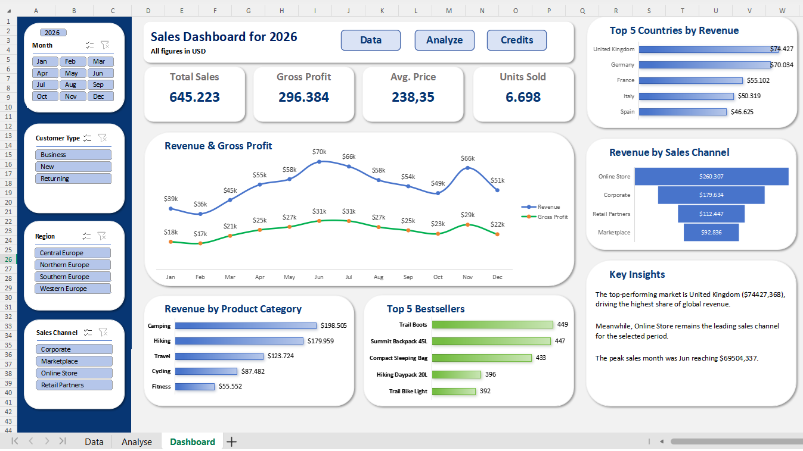

# Interactive Sales Dashboard | Excel

An interactive sales dashboard created in an Excel-compatible spreadsheet environment as a guided learning project, focusing on dashboard design, data visualization, and interactive reporting.

## Project Overview

This project explores sales performance for a fictional outdoor products company operating across European markets.

The main objective was to practise designing a visually appealing, interactive business dashboard using Pivot Tables, KPI cards, charts, and slicers.

The dashboard was developed following a tutorial by **Kenji Explains**, with the original learning resource credited below.

## Dashboard Features

### Key Performance Indicators (KPIs)

- **Total Sales:** $645,223
- **Gross Profit:** $296,384
- **Average Price:** $238.35
- **Units Sold:** 6,698

### Visualizations

- **Monthly Revenue & Gross Profit:** comparison of sales and profitability trends throughout 2026.
- **Top 5 Countries by Revenue:** ranking of the highest-revenue European markets.
- **Revenue by Sales Channel:** comparison of sales performance across different channels.
- **Revenue by Product Category:** analysis of revenue contributions by product category.
- **Top 5 Bestsellers:** ranking of best-selling products by units sold.

### Interactive Features

The dashboard includes slicers for:

- Month
- Customer Type
- Region
- Sales Channel

It also includes navigation buttons for the Data and Analyse worksheets and a Credits button linking to the original tutorial.

## Tools and Techniques

- Excel-compatible spreadsheets (WPS Spreadsheets)
- Pivot Tables
- Pivot Charts and standard charts
- Slicers
- KPI reporting
- Dashboard layout and formatting
- Sales performance visualization

## Workbook Structure

| Worksheet | Purpose |
|---|---|
| `Data` | Sales dataset |
| `Analyse` | Pivot Tables and supporting calculations |
| `Dashboard` | Interactive dashboard and visualizations |

## Project Files

- `02_Project/Interactive_Sales_Dashboard.xlsx` — completed interactive dashboard.
- `03_Screenshots/dashboard_overview.png` — dashboard preview.

## Learning Outcomes

Through this project, I practised:

- Organizing data for reporting using Pivot Tables.
- Presenting business KPIs in a clear visual layout.
- Comparing sales performance across time, markets, products, and sales channels.
- Adding interactive filtering to improve data exploration.
- Designing a consistent dashboard interface with navigation elements.

## Project Scope

This is a **guided educational project**, primarily focused on spreadsheet dashboard design and interactive visualization rather than an independently developed business case study.

Future improvements may include additional validation of KPI definitions, formatting consistency, and more detailed business insights.

## Credits and Acknowledgements

This dashboard was developed as a hands-on exercise based on the tutorial by **Kenji Explains**.

**Original tutorial:** [Interactive Sales Dashboard in Excel — Kenji Explains](https://www.youtube.com/watch?v=3GceuJe_PYc)

Credit for the original tutorial, learning material, and dashboard concept belongs to their respective creator.

## Author

**Eder Tolentino**

[GitHub](https://github.com/EderTolentino) | [LinkedIn](https://www.linkedin.com/in/edertolentino/)
